 

## 👨‍💻 About Me

I'm **Md Moniruzzaman Tonoy** — a **Full Stack Web Developer** from **Kendua, Netrokona, Bangladesh**. I turn ideas into fast, clean and interactive web experiences: pixel-perfect interfaces on the front, practical and secure APIs on the back.

<table>
<tr>
<td width="50%" valign="top">

**🔭 Currently**
- 💼 Instructor at **[Open IT Institute](https://openitinstitute-c8d2d.web.app/)**
- 🎓 Finishing HSC (Science) at Kendua Government College
- 🧪 Building full-stack products & exploring **Generative AI**

</td>
<td width="50%" valign="top">

**🤝 Open to**
- 💻 Junior developer roles
- 🧑‍🤝‍🧑 Freelance & collaborations
- 🌍 Meaningful, user-focused web projects

</td>
</tr>
<tr>
<td colspan="2">

**💬 Ask me about:** React · Next.js · Tailwind CSS · Node.js / Express · MongoDB · Firebase · REST APIs · Microsoft Office · Graphic design

</td>
</tr>
</table>

## 🧰 Tech Stack

  

| | |
| :-- | :-- |
| **🎨 Frontend** |         |
| **⚙️ Backend & Data** |       |
| **🛠 Tools & Deploy** |        |
| **🎓 Also** |     |

## 🚀 Featured Projects

<table>
<tr>
<td width="50%" valign="top">

### 🎓 Open IT Institute
**Educational website & management platform**

Courses, student admissions and admin workflows for an IT training institute — responsive pages, dashboards and API-based data management.

   

[🔗 Live Demo](https://openitinstitute-c8d2d.web.app/)

</td>
<td width="50%" valign="top">

### 🛍️ Gadget Heaven
**E-commerce platform for premium tech accessories**

Modern shopping experience with cart sync across devices, secure payments and performance tuned for a large catalog.

   

[🔗 Live Demo](https://magical-gumption-061d0e.netlify.app/) · [📂 Source](https://github.com/nur922184/gadget-heaven-accessories)

</td>
</tr>
<tr>
<td width="50%" valign="top">

### 💍 LifeLink
**Biodata & matchmaking platform**

Smart matching and community building with Firebase authentication, protected pages, role-based access (premium & admin) and real-time chat.

   

[🔗 Live Demo](https://my-final-project-36ab9.web.app/) · [📂 Source](https://github.com/nur922184/life-link-client)

</td>
<td width="50%" valign="top">

### 🤝 CrowdFund
**Crowdfunding platform for creators**

Campaign creation and verification, real-time funding updates and a compliant, secure payment flow.

   

[🔗 Live Demo](https://my-assignment-ten-57a0d.web.app/) · [📂 Source](https://github.com/nur922184/crowd-funding-client-10)

</td>
</tr>
<tr>
<td width="50%" valign="top">

### ❄️ Winter Clothing Donation
**Donor ↔ volunteer platform**

Connects donors with volunteers to help vulnerable people in winter — secure authentication and real-time donation data.

  

[🔗 Live Demo](https://assignment-nine-4896f.web.app/)

</td>
<td width="50%" valign="top">

### 🌐 MT — Personal Portfolio
**Animated 3D portfolio (this very profile's home)**

Next.js static export with a live color-shifting theme, light/dark mode, a 3D globe that showcases my skills, blog, SEO and Firebase Hosting.

   

[🔗 Explore Portfolio](https://md-moniruzzaman-tonoy.web.app/)

</td>
</tr>
</table>

> 🤖 **OpenIT AI** — an AI-focused project built around conversational interfaces. *Details coming soon.*

## 💼 Experience & Education

| When | What | Where |
| :-- | :-- | :-- |
| **2021 – Present** | 🧑‍🏫 **Instructor & Graphics Designer** — teaching Microsoft Office (Word, Excel, PowerPoint, Access) and web development fundamentals; designing logos, banners and social media graphics | [Open IT Institute](https://openitinstitute-c8d2d.web.app/) |
| **2024 – Present** | 💻 **Complete Web Development Course (Batch 10)** & internship — React, Node.js, Express, MongoDB, REST APIs, authentication, performance and deployment | [Programming Hero](https://www.programming-hero.com/) |
| **2024 – Present** | 🎓 **Web Design & Development** program | Open IT Institute |
| **2025 – 2026** | 🎓 **HSC — Science** (Mathematics & Computer Science) | Kendua Government College |
| **2023 – 2024** | 🎓 **SSC — Science** | Kendua Joyhori Spri Govt. High School |

## ✍️ From My Blog

| Article | Topic |
| :-- | :-- |
| [Getting Started with React Hooks](https://md-moniruzzaman-tonoy.web.app/blog/modern-react-hooks-complete-guide/) | React |
| [Mastering Tailwind CSS](https://md-moniruzzaman-tonoy.web.app/blog/mastering-tailwind-css-modern-ui/) | CSS |
| [Node.js Best Practices](https://md-moniruzzaman-tonoy.web.app/blog/nodejs-express-backend-development/) | Node.js |
| [Responsive Design Principles](https://md-moniruzzaman-tonoy.web.app/blog/responsive-web-design-complete-guide/) | Web |
| [Introduction to MongoDB](https://md-moniruzzaman-tonoy.web.app/blog/mongodb-database-design-guide/) | Database |
| [JavaScript ES6+ Features](https://md-moniruzzaman-tonoy.web.app/blog/javascript-es6-modern-development/) | JavaScript |

## 📊 GitHub Analytics

### 🐍 Contribution Snake

<picture>
  <source media="(prefers-color-scheme: dark)" srcset="https://raw.githubusercontent.com/moniruzzaman2428/moniruzzaman2428/output/github-snake-dark.svg" />
  <source media="(prefers-color-scheme: light)" srcset="https://raw.githubusercontent.com/moniruzzaman2428/moniruzzaman2428/output/github-snake.svg" />
  
</picture>

## 🎯 What I'm Working Toward

- 🏗️ Building scalable, maintainable full-stack applications
- ⚛️ Going deeper into JavaScript, React / Next.js and backend architecture
- 🤖 Learning conversational AI, chatbot workflows and Generative AI integrations
- 📚 Creating educational tools that help people learn technology

## 📬 Let's Connect

I'm happy to connect with developers, collaborators, recruiters and teams building useful digital products.

### ✨ Keep learning. Keep building. Keep improving.

**Thanks for visiting my profile — a ⭐ on my repos means a lot!**

